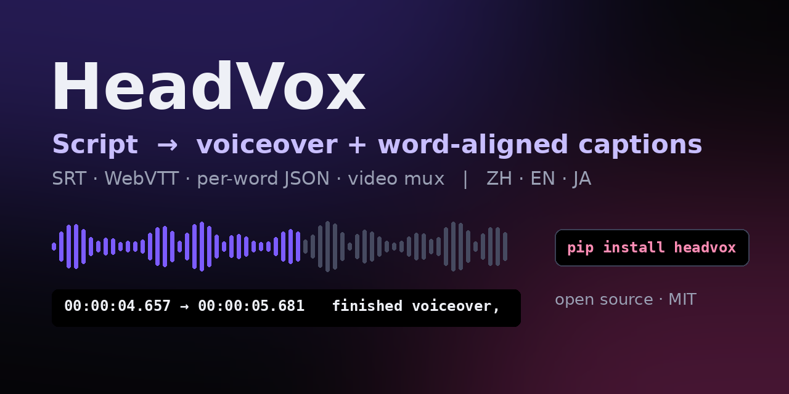
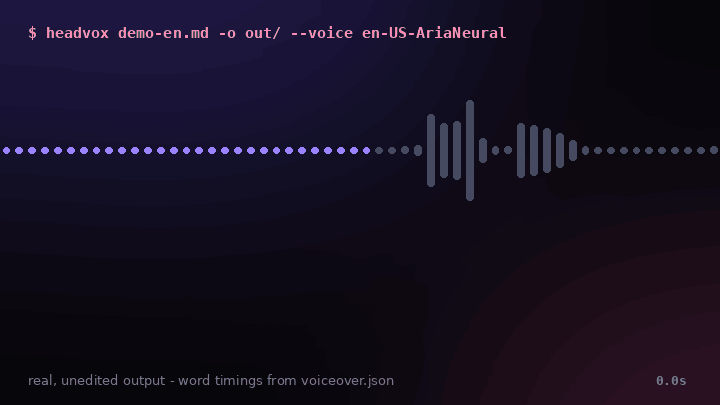
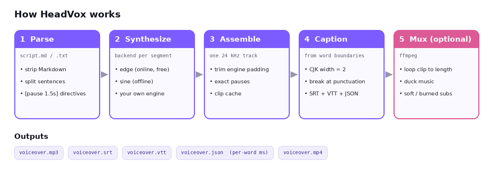

<div align="center">



# HeadVox

**Script → voiceover + word‑aligned SRT/VTT captions + per‑word JSON timings, in one command.**

[](https://pypi.org/project/headvox/)
[](https://pypi.org/project/headvox/)
[](https://github.com/yyert123/headvox/blob/main/LICENSE)
[](https://huggingface.co/spaces/headvox/headvox)
[](https://github.com/yyert123/headvox/blob/main/README.zh-CN.md)
[](https://github.com/yyert123/headvox/blob/main/README.ja.md)

**English** · [简体中文](https://github.com/yyert123/headvox/blob/main/README.zh-CN.md) · [日本語](https://github.com/yyert123/headvox/blob/main/README.ja.md)



<sub>Real, unedited output of <code>headvox examples/demo-en.md --voice en-US-AriaNeural</code>. The highlighted word is driven by <code>voiceover.json</code>. <a href="https://github.com/yyert123/headvox/blob/main/assets/demo-en.mp4">Watch with sound (MP4)</a> · <a href="https://huggingface.co/spaces/headvox/headvox">more samples, incl. Chinese</a></sub>

</div>

---

**HeadVox** is a free, MIT‑licensed Python CLI and library for creators who write their own scripts. Give it a plain‑text or Markdown script and it produces a neural text‑to‑speech voiceover, **SRT and WebVTT captions timed to the words as they are actually spoken**, and a **JSON manifest with millisecond timings for every word** — then, if you like, puts it all on your talking‑head or B‑roll clip with ffmpeg. Chinese, English and Japanese are first‑class, including width‑aware caption breaking for CJK text.

## ✨ Highlights

- 🎯 **Captions that don't drift** — cues are built from the TTS engine's own word‑boundary events, not estimated from character counts.
- 🀄 **CJK‑aware line breaking** — a Chinese/Japanese character counts as two columns; lines break at punctuation inside a width budget, so mixed 中文 + English fits a 9:16 screen.
- 🧭 **Per‑word JSON** — drive karaoke captions, avatar lip‑sync, B‑roll cuts or chapter markers (the GIF above is rendered from it).
- ⏸️ **Pacing control** — automatic sentence/paragraph pauses plus `[pause 1.5s]` anywhere.
- 📝 **Markdown in, speech out** — headings, emphasis, links, lists and code fences are reduced to what a narrator would say.
- 🎬 **One‑step video** — loop a clip to the voiceover length, duck background music, add soft or burned‑in subtitles.
- ⚡ **Clip cache** — re‑rendering after a small edit is ~8× faster on our demo scripts (see [Performance](#-performance)).
- 🧩 **Pluggable backends** — free online `edge` voices (no API key), offline `sine` for tests, or your own engine in ~10 lines.
- 🪶 **Zero required dependencies** — pure Python + ffmpeg. No model download, no GPU.

## 📰 News

- **2026‑11‑08** · v0.1.1 — full docs in English / 简体中文 / 日本語, reproducible benchmark script, live samples page.
- **2026‑11‑08** · v0.1.0 — first public release on [PyPI](https://pypi.org/project/headvox/).

## Contents

- [Quick start](#-quick-start) · [What you get](#-what-you-get) · [Performance](#-performance) · [How it works](#%EF%B8%8F-how-it-works)
- [Writing a script that sounds good](#writing-a-script-that-sounds-good) · [Recipes](#recipes) · [Python API](#python-api) · [Timing manifest](#timing-manifest) · [Voices](#voices)
- [Which tool should I use?](#-which-tool-should-i-use) · [Roadmap](#%EF%B8%8F-roadmap) · [Troubleshooting](#troubleshooting) · [FAQ](#faq)
- [Risks & limitations](#%EF%B8%8F-risks--limitations) · [Contributing](#-contributing) · [Citation](#-citation) · [Acknowledgments](#-acknowledgments)

## 🚀 Quick start

```bash
pip install "headvox[edge]"      # Python 3.9+; also needs ffmpeg + ffprobe on PATH
headvox script.md -o out/ --voice en-female
```

```bash
headvox script.md -o out/ --voice zh-male --rate +8          # another voice, a bit faster
headvox script.md --dry-run                                  # preview segmentation, no TTS call
headvox script.md -o out/ --video avatar.mp4 --music bed.mp3 # straight to a finished MP4
echo "Hello from HeadVox." | headvox - -o out/               # read from stdin
```

ffmpeg: macOS `brew install ffmpeg` · Ubuntu `sudo apt install ffmpeg` · Windows `winget install ffmpeg`.

<details>
<summary><b>All CLI options</b></summary>

| Option | Default | What it does |
|---|---|---|
| `-v, --voice` | `zh-female` | preset (`zh-female`, `zh-male`, `en-female`, `en-male`, `ja-female`, `ja-male`) or any edge‑tts voice id |
| `-b, --backend` | `edge` | `edge`, `sine`, or a registered custom backend |
| `--rate` / `--pitch` / `--volume` | `0` | speed %, pitch Hz, volume % (e.g. `+8`, `-5`) |
| `--format` | `mp3` | `mp3`, `wav`, `m4a` |
| `--sentence-pause` / `--paragraph-pause` | `250` / `700` | silence in ms |
| `--caption-chars` | `42` | caption width budget (CJK char = 2) |
| `--video` | – | clip to put the voiceover on |
| `--fit` | `loop` | `loop` the clip to the audio length, or cut to `audio` |
| `--music` / `--music-volume` | – / `0.12` | background bed, looped and ducked |
| `--burn-subs` / `--no-subs` | off | burn captions into the picture / attach none |
| `--proxy` | – | HTTP proxy for the online backend (or `HEADVOX_PROXY`) |
| `--dry-run` | off | print the segments and exit |

</details>

## 📦 What you get

| File | What it is | Typical use |
|---|---|---|
| `voiceover.mp3` | the narration (24 kHz; `wav`/`m4a` optional) | drop on your editor's audio track |
| `voiceover.srt` | captions, word‑aligned | Premiere, Resolve, Final Cut, CapCut/剪映, YouTube upload |
| `voiceover.vtt` | same captions as WebVTT | HTML5 `<track>`, web players |
| `voiceover.json` | segments + per‑word `start_ms`/`end_ms` + cues | karaoke captions, lip‑sync, auto B‑roll cuts |
| `voiceover.mp4` | *(with `--video`)* clip + voice + music + subtitles | publish directly |

## 📊 Performance

Measured with [`scripts/bench.py`](https://github.com/yyert123/headvox/blob/main/scripts/bench.py) on the two demo scripts in [`examples/`](https://github.com/yyert123/headvox/blob/main/examples) — a 2‑vCPU aarch64 cloud sandbox, Python 3.12, edge voices reached through an HTTP proxy (2026‑11‑08). *Cold* includes the network round‑trips to the TTS service; *cached* is a re‑run with the clip cache warm.

| Script | Backend / voice | Audio | Captions | Widest cue | Overlaps | Cold | Cached | Cold RTF |
|---|---|---|---|---|---|---|---|---|
| `demo-en.md` | edge · en‑US‑AriaNeural | 20.1 s | 9 | 41 / 42 | 0 | 5.75 s | 0.63 s | 0.29 |
| `demo-zh.md` | edge · zh‑CN‑XiaoxiaoNeural | 23.2 s | 8 | 38 / 42 | 0 | 5.25 s | 0.65 s | 0.23 |
| `demo-en.md` | sine (offline) | 18.4 s | 9 | 39 / 42 | 0 | 0.93 s | 0.60 s | 0.05 |

RTF = processing time ÷ audio duration (lower is faster). Your numbers will mostly depend on your network latency to the TTS service. Reproduce:

```bash
pip install "headvox[edge]"
python scripts/bench.py examples/demo-en.md --voice en-US-AriaNeural
python scripts/bench.py examples/demo-zh.md --voice zh-CN-XiaoxiaoNeural
```

## ⚙️ How it works



1. **Parse** — split the script into speakable segments, strip Markdown, honour `[pause]` directives.
2. **Synthesize** — call the backend per segment, cached by text + voice settings.
3. **Assemble** — build one 24 kHz track, trimming engine padding so pauses are exact.
4. **Caption** — build cues from word boundaries, breaking at punctuation within a CJK‑aware width budget; cues never overlap.
5. **Mux** *(optional)* — ffmpeg loops the clip, ducks music with sidechain compression, adds soft or burned‑in subtitles.

## Writing a script that sounds good

- **One idea per sentence.** Shorter sentences give shorter, punchier captions and more natural breathing.
- **Use blank lines between paragraphs** — they become longer pauses (`--paragraph-pause`).
- **Add beats deliberately:** `That's it. [pause 0.8s] Now the fun part.`
- **Spell out what should be said:** write "two thousand twenty‑six" or "v zero point one" if the engine mispronounces a token.
- **Markdown is fine** — `# Headings` are spoken as plain sentences, `**bold**` loses its asterisks, code fences are skipped.
- For vertical video (9:16) try `--caption-chars 28`; for 16:9 the default 42 works well.

## Recipes

**YouTube Shorts / TikTok / Douyin (9:16, burned‑in captions)**
```bash
headvox short.md -o out/ --voice en-male --rate +6 --caption-chars 28 \
        --video portrait_avatar.mp4 --burn-subs --music bed.mp3
```

**Course lesson with toggleable subtitles (16:9)**
```bash
headvox lesson-03.md -o lesson-03/ --voice zh-female --video slides.mp4 --fit audio
```

**Bilingual versions from two scripts**
```bash
headvox intro.zh.md -o out/zh --voice zh-female
headvox intro.en.md -o out/en --voice en-female
```

**Import into an editor** — drop `voiceover.mp3` + `voiceover.srt` into Premiere Pro, DaVinci Resolve, Final Cut (via SRT import) or CapCut/剪映; the captions land on the right frames.

**Batch a folder**
```bash
for f in scripts/*.md; do headvox "$f" -o "out/$(basename "$f" .md)"; done
```
Unchanged sentences come from the cache, so re‑runs are fast.

**Make a karaoke preview like the one above** — `python scripts/render_demo.py out/` renders frames from any output folder (needs `numpy` and `pillow`).

## Python API

```python
from headvox import synthesize, Script, VoiceSettings

res = synthesize(
    Script.from_file("talk.md"),
    "out/",
    backend="edge",
    settings=VoiceSettings(voice="zh-CN-XiaoxiaoNeural", rate_pct=5),
)
print(res.duration_ms, "ms,", len(res.cues), "captions")
for cue in res.cues:
    print(cue.start_ms, cue.end_ms, cue.text)
```

`synthesize()` returns the paths of the audio, SRT, VTT and manifest, the total duration, the caption cues and per‑segment word timings.

### Custom backend

```python
from headvox.backends import SegmentAudio, WordMark, register_backend

class MyBackend:
    name = "mine"
    def synthesize_segment(self, text, settings):
        audio, fmt, dur = my_tts(text, settings.voice)   # bytes, "wav"/"mp3", ms
        return SegmentAudio(audio, fmt, dur, [WordMark("hi", 0, 200)])

register_backend("mine", lambda **kw: MyBackend())
```
Then `headvox script.md -b mine`. Any engine that can report word timings (or that you align afterwards) gets HeadVox's captioning, pacing, caching and muxing for free.

## Timing manifest

`voiceover.json` holds everything downstream tools need:

```json
{
  "tool": "headvox",
  "backend": "edge",
  "duration_ms": 19600,
  "segments": [
    {"index": 0, "text": "Hi everyone, and welcome back.",
     "start_ms": 250, "end_ms": 2232,
     "words": [{"text": "Hi", "start_ms": 250, "end_ms": 412}]}
  ],
  "cues": [{"index": 1, "start_ms": 250, "end_ms": 2232, "text": "Hi everyone, and welcome back."}]
}
```

Use it to drive mouth shapes on an avatar, highlight the active word (karaoke‑style captions), cut B‑roll on sentence boundaries, or generate chapter markers.

## Voices

| Preset | edge‑tts voice |
|---|---|
| `zh-female` | `zh-CN-XiaoxiaoNeural` |
| `zh-male` | `zh-CN-YunxiNeural` |
| `en-female` | `en-US-AvaMultilingualNeural` |
| `en-male` | `en-US-AndrewMultilingualNeural` |
| `ja-female` | `ja-JP-NanamiNeural` |
| `ja-male` | `ja-JP-KeitaNeural` |

Any other edge‑tts voice id works too (`edge-tts --list-voices`), which opens up many more languages and accents; caption line‑breaking is tuned for CJK and Latin scripts.

## 🤔 Which tool should I use?

Honest positioning — pick the tool that fits the job:

| You want… | Good fit |
|---|---|
| One‑liner TTS of a short string to MP3 | the `edge-tts` CLI itself |
| Voice cloning / voice design / studio‑grade local speech models | a model such as VoxCPM, CosyVoice or F5‑TTS (GPU recommended) |
| "Topic → AI script → stock footage → video" automation | an end‑to‑end short‑video generator |
| Subtitles for a video that **already has speech** | a Whisper‑based transcription tool |
| **Your own script** → voiceover + captions that match it word for word, CJK‑friendly, with pause control, a reusable timing file, and optional mux onto your clip | **HeadVox** |

HeadVox is deliberately the focused, composable layer between "a script" and "a publishable clip": it hands clean MP3/SRT/VTT/JSON/MP4 files to whatever editor or pipeline you already use, and any speech engine can sit behind it as a backend.

## 🗺️ Roadmap

- [ ] Local‑model backends (e.g. VoxCPM / CosyVoice) with word timings, for fully offline and cloned voices
- [ ] ASS output with styled / karaoke captions
- [ ] Multi‑speaker scripts (`[voice zh-male]` switches)
- [ ] Per‑language line‑breaking rules beyond CJK + Latin
- [ ] Optional web UI

Ideas and PRs welcome — open an [issue](https://github.com/yyert123/headvox/issues).

## Troubleshooting

| Symptom | Fix |
|---|---|
| `ffmpeg not found` | install ffmpeg and make sure `ffmpeg` and `ffprobe` are on PATH |
| `NoAudioReceived` from edge | the voice id is wrong or temporarily unavailable — try another voice, or retry |
| Network blocked / corporate proxy | `--proxy http://host:port` or `export HEADVOX_PROXY=...` |
| `--burn-subs` fails | your ffmpeg lacks libass; use soft subtitles (default) or install a full ffmpeg build |
| Captions too long on vertical video | lower `--caption-chars` (e.g. 24–28) |

## FAQ

**Is HeadVox free?** Yes. HeadVox is MIT‑licensed. The default `edge` backend uses the free online service behind Microsoft Edge's read‑aloud via the `edge-tts` package; it needs internet but no API key or account.

**Does it work offline?** Parsing, stitching, captioning and video muxing are fully local. Speech synthesis with `edge` needs internet; plug in a local engine through the backend API for a fully offline setup.

**Why are the captions more accurate than splitting by sentence?** HeadVox uses the word‑boundary events the engine emits while speaking, trims the leading/trailing silence some engines add, and then places line breaks — so each cue starts when its first word is actually heard.

**Can it generate a talking‑head avatar?** No — HeadVox doesn't render faces. It produces the voiceover, captions and per‑word timings that an avatar or lip‑sync tool consumes, and it can put the result on an avatar clip you already have.

**Can I use the output commercially?** HeadVox's code is MIT. Rights to synthesized speech depend on the TTS service you use — check its terms for your use case.

**Is this affiliated with Microsoft or edge‑tts?** No. HeadVox is an independent, original project that uses `edge-tts` as one optional backend.

## ⚠️ Risks & limitations

- **Online backend.** The default `edge` backend sends your script text to Microsoft's online read‑aloud service and needs internet. Use a local backend for confidential scripts.
- **Voice rights.** HeadVox's code is MIT, but the rights to synthesized speech come from the TTS service you use — check its terms for commercial use.
- **Disclosure.** Synthetic narration can be mistaken for a real person. Don't use it to impersonate anyone, and label AI‑voiced content where your platform or audience expects it.
- **Engine availability.** Individual voices can be temporarily unavailable (`NoAudioReceived`); switch voice or retry.
- **Scope.** HeadVox does not render faces, clone voices or transcribe existing audio.

## 🤝 Contributing

```bash
git clone https://github.com/yyert123/headvox.git
cd headvox
pip install -e ".[dev]"
pytest            # runs fully offline via the 'sine' backend
```

Especially welcome: new backends, line‑breaking rules for more languages, caption styles, and docs translations.

## 📖 Citation

If HeadVox helps your course, research or product, please cite it via [`CITATION.cff`](https://github.com/yyert123/headvox/blob/main/CITATION.cff) (GitHub's "Cite this repository" button), and consider starring ⭐ the repo.

## 📄 License

[MIT](https://github.com/yyert123/headvox/blob/main/LICENSE). HeadVox is original work and is not affiliated with Microsoft or the `edge-tts` project.

## 🙏 Acknowledgments

- [edge-tts](https://github.com/rany2/edge-tts) for the Python client to Microsoft Edge's online voices
- [FFmpeg](https://ffmpeg.org/) for audio/video processing
- Everyone who tries HeadVox, files issues and sends ideas

## ⭐ Star history

[](https://star-history.com/#yyert123/headvox&Date)

<!-- keywords: text to speech, TTS, voiceover generator, AI voiceover, subtitle generator, SRT generator, WebVTT, word-level timestamps, karaoke captions, talking head video, faceless video, YouTube Shorts, TikTok, Bilibili, Douyin, edge-tts, Chinese TTS, Japanese TTS, 文字转语音, 配音, 口播, 字幕生成, 音声合成, 字幕 -->
